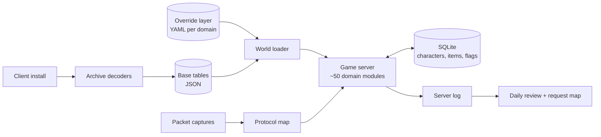

# Legacy MMO Revival

How we brought a shut-down 2000s online game back to life when the only thing left was the game client.

The publisher's servers went dark years ago. No server code, no database dumps, no documentation. What survived was the client installer that players still had on old disks. This repo describes the architecture and method we used to rebuild a working, multiplayer server from that client alone, and how we run it now with a live player community.

This is a write-up, not a codebase. It contains no game data, no client files and no server code.

## The core idea: the client is the specification

A game client has to know almost everything about the game to draw it: every item, its stats and who may wear it, every skill and its effect, every map, its walls and its exits, every quest line and every NPC's lines. The server's rules are mostly *implied* by that data. So instead of inventing a game server, we:

1. **Decode the client's data archives** into plain tables (items, skills, buffs, monsters, quests, maps, collision).
2. **Read the network protocol** by watching what the client sends and what it expects back.
3. **Build the server around those tables**, so the game behaves the way its original designers specified.
4. **Change the design only on purpose**, in a separate override layer, with every change logged and explained.

The rule we follow when a player asks for something: *rebuild the original design from client data; deviate only where it saves players time.*

## What's in here

| Document | What it covers |
|---|---|
| [docs/architecture.md](docs/architecture.md) | The layers: decoded base data, override layer, server, persistence, operations |
| [docs/reverse-engineering.md](docs/reverse-engineering.md) | How we decoded the data and the protocol, step by step |
| [docs/request-routing.md](docs/request-routing.md) | How player requests are triaged against the original design: lanes, impact tags, polls |
| [docs/lessons.md](docs/lessons.md) | What went wrong and what we'd tell anyone attempting the same |

## At a glance

## Status

Running for a small community, with roughly 50 different players a day, about 340 characters, and around 150 automated end-to-end tests that must pass before every deploy.
