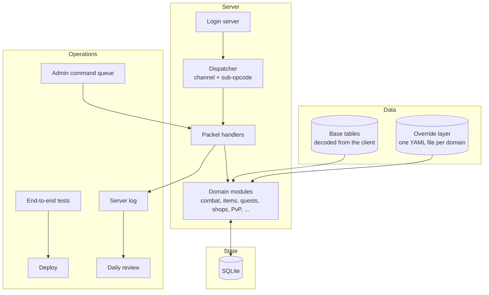

# Architecture

Five layers, each with one job. Data flows down; nothing lower reaches up.

## 1. Base tables: the client's data, decoded

Every table the client ships is decoded once into JSON and kept read-only:

- **Items**: name, description, slot/class, level requirement, price, the job a piece is tied to, attack and defence types, upgrade growth values, set membership, durability.
- **Skills and buffs**: damage type, cooldowns, durations, whether a buff stuns or seals.
- **Monsters and drops**, **quests** (steps, NPCs, rewards), **maps** (NPC placement, exits, collision grids).

We keep two forms of the item table: a *decoded* form with names and readable fields, and a *raw* form with each record's bytes. The raw form matters. Every time we found a new meaning for a byte (say, which byte holds an armour's defence type), we added one line to the raw reader instead of re-decoding everything.

Nothing in the base layer is ever edited by hand. If the client says it, the base layer says it.

## 2. Override layer: every deliberate change, in one place

Changes to the original design live in small YAML files, one per domain: drops, shops, PvP rules, travel, events, organisations, formulas and so on (about 40 files). The server addresses each table by its file name, so a domain module asks for "the drops table" and gets base data with that file's overrides merged on top.

Two rules keep this honest:

- **Formulas are data.** Damage, salary, jail time and exp curves are expressions stored in YAML (`"500 + level * 20"`), evaluated by a tiny safe evaluator. Balancing a number never needs a code change.
- **Every deviation is tagged** with who asked, when, and why, in a comment next to the change. Collecting those tags gives a full register of how far each part of the game has moved from the original.

## 3. The server

**Login server.** It speaks the client's login and character-select protocol and hands the connection to the game loop.

**Dispatcher.** Game packets arrive as *channel + sub-opcode + body*. One dispatcher routes them to a handler. Any packet that gets no reply is logged as `(no reply for ...)`. That single log line was our best tool for finding protocol features we hadn't built yet (see [reverse-engineering.md](reverse-engineering.md)).

**Handlers and domain modules.** Handlers decode packets and call into about 50 domain modules (combat, equipment, upgrades, quests, shops, trading, PvP, outlaws and jail, organisations, territory wars, events). Domain modules hold the rules and never touch sockets.

**Hot reload.** Domain modules are reloaded from disk while the server runs, so most fixes go live without disconnecting anyone. Changes to session handling still need a restart.

**Multiplayer.** Each connection has its own session state; shared world state sits behind one global lock. Simple, slow to scale, and plenty for a community of this size.

**Fake NPCs.** Some NPCs the original design needed don't exist on the map where we need them. A small table places extra NPCs that reuse an existing NPC record and can open quests or menus.

## 4. State

SQLite holds accounts, characters, inventory, equipment and a ledger of premium-currency purchases (so a refund matches the exact copy bought). Most feature state lives in one generic **flags** table, `(character, name, value)`, which means adding a feature (a daily counter, a once-only reward, a faction membership) needs no schema change.

## 5. Operations

**Admin command queue.** Operators don't log into a console. They drop a JSON command file (give an item, grant currency, broadcast a notice), written atomically to a temporary file and renamed into place. The server picks it up on that player's next packet. That gives an auditable, scriptable admin path with no extra listening port.

**Tests.** About 150 end-to-end tests drive a fake client through the real handlers against a copy of the database. They exercise packets in and packets out, not internal functions, because almost every real bug we hit was an integration bug (see [lessons.md](lessons.md)). The tests share one database copy, so they run strictly one at a time.

**Deploy.** One script syncs the server to a small VPS reachable only over a private mesh VPN. After every deploy we check two things in the log: the handlers reloaded, and the error count is zero.

**Daily review.** Every day the log, the database and the community channels are rolled up into a private review page: players, sign-ups, PvP, deaths, errors, open concerns, every player request, and the design map (see [request-routing.md](request-routing.md)).
