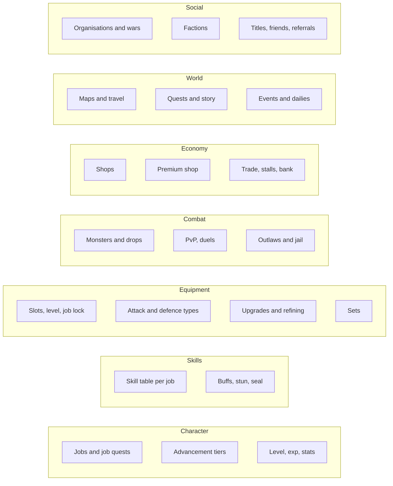

# Routing player requests

Once players are back, requests arrive every day: change this mission, add that item, make this weapon stronger, ban fighting in that room. Around 180 messages a day at our peak. Without a system, every request is a judgment call made from memory, and the game drifts away from its own design one reasonable-sounding change at a time.

## The design map

The map has one **lane** per system the client itself defines. Each lane splits into **nodes**:

Every node records the same five things:

1. **Original:** what the client data (and old guides) define here.
2. **Ours:** which server modules and override files implement it.
3. **Deviations:** how many tagged changes we've made, collected automatically from the code.
4. **Impact:** who feels a change here (PvP, PvE, economy).
5. **Default route:** how a change here gets decided.

## One home, several impacts

A tree alone doesn't work, because most requests cross lanes. A stronger weapon upgrade *lives* in Equipment, but it changes PvP fights, PvE grinding speed and premium-shop spending. So each request gets:

- **One home lane:** where the code and data change.
- **Impact tags:** everyone who feels it.

The tags decide the process, not the home lane. A change that touches PvP is put to every player through a vote, even if its code lives in Equipment.

## Three routes

| Route | When | Example |
|---|---|---|
| **Fix** | Our server differs from the original by mistake: a logic bug. | A skill kill froze the winner; a quest step never completed. |
| **Poll** | It adds or changes a rule. One yes/no question, 48 hours, simple majority. Anything touching PvP is polled for every job. | Should fighting be banned indoors? Should a job get a damage bonus? |
| **Owner** | Big, costly, or a tie. | A new storyline; a three-way tied vote. |

Formula questions follow the same split. If a player reports a number that "feels wrong", first check it against the original data. If ours differs, it's a bug and gets fixed. If ours matches and they want it changed, that's a balance question: pull the data first, then the owner or a poll decides.

## The ledger

Every request becomes a card: who asked and where, the ask, home lane, impact tags, route, status (new, poll open, building, shipped, needs owner), and a link to the poll or announcement. The daily review shows the cards as swimlanes by lane, so the owner can see the whole queue without asking.

## Why this matters

The deviation count per node turned out to be the most useful number on the map. It shows where the game has drifted furthest from its original design. In our case that is map travel (fixing broken exits) and PvP, and those are exactly the places where new requests are most likely to conflict with old decisions.
